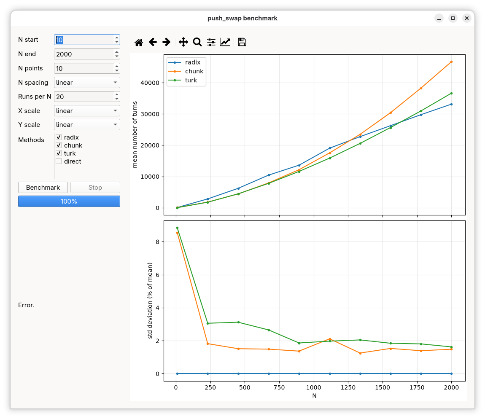

# push_swap benchmark

Python port of a 42 `push_swap` project, with a PyQt6 GUI to benchmark the
sorting methods. It measures the number of operations ("turns") each method
needs as a function of the stack size N.



To test your `push_swap` code in C, you can use the  [push_swap visualizer](https://github.com/AVKOR42/push_swap_viz00).

## Requirements

- Python 3.10+
- `PyQt6`, `matplotlib`

```bash
pip install PyQt6 matplotlib
```

## Run

From the project root:

```bash
python bench.py
# or
chmod +x bench.py && ./bench.py
```

## Project layout

```
bench.py            entry point (launches the GUI)
src/
  gui.py            PyQt6 + matplotlib benchmark window
  benchmark.py      make_sizes(), make_stacks(), benchmark_point()
  algorithms.py     ALGORITHMS registry: method name -> sort function
  stack.py          Stack class (data, ranks `ind`, find_min/find_max, is_sorted)
  push.py           push
  swap.py           swap, ss
  rotate.py         rotate, rrotate, rotate_all, rrotate_all, rotate_n
  radix.py          radix sort
  chunk.py          chunk / butterfly sort
  direct.py         direct (selection) sort, sort3
  turk.py           Turk algorithm
  tools.py          INT_MIN / INT_MAX, test_int
  worker.py			Benchmark Worker based QThread
```

## Sorting methods

| Method   | Idea                                                                 | Cost             |
|----------|----------------------------------------------------------------------|------------------|
| `radix`  | One pass per bit of the rank; `pb` or `ra` depending on the bit      | O(n log n) turns |
| `chunk`  | Push to `b` in a butterfly shape by rank chunks, pull back the max   | about 1100 turns for N=100, 5500 for N=500 |
| `turk`   | Always push the element with the cheapest combined rotation cost     | about 700 turns for N=100, 5500 for N=500 |
| `direct` | Push the minimum to `b` each time, then pull everything back         | O(n^2) turns     |

Radix always performs the same number of turns for a given N, so its standard
deviation is exactly 0. The other methods depend on element positions, so their
deviation is non-zero.

`direct` and `turk` get slow for large N (see Performance).

## How it works

Every operation (`push`, `swap`, `rotate`, ...) returns its name as a string
(`"pa"`, `"rrb"`, ...), and every sort function returns the list of operations
it performed. The number of turns is `len(ops)`.

For each N, the benchmark builds `Runs per N` random permutations of `0..N-1`,
runs the selected method on each, checks that the result is sorted, and
records the mean and standard deviation of the operation count.

## GUI

| Control       | Meaning                                                        |
|---------------|----------------------------------------------------------------|
| N start / end | Range of stack sizes (both included)                           |
| N points      | Number of N values to test                                     |
| N spacing     | `linear` or `log` distribution of the N values                 |
| Runs per N    | Number of random inputs per N                                  |
| X / Y scale   | `linear` or `log` axes of the plots (can be changed any time)  |
| Methods       | Tick one or several methods, one curve each                    |
| Benchmark     | Run the benchmark                                              |
| Stop          | Stop the run and keep the partial results                      |

Hover over any control to see a tooltip describing it.

Two plots are shown, both as a function of N:

- the mean number of turns (X and Y scales selectable),
- the standard deviation as a percentage of the mean (the Y axis is always
  linear, because the value can be exactly 0).

Example: N spacing `log`, 4 points, 10 to 10000 tests N = 10, 100, 1000, 10000.
Rounding to integers can merge neighbouring values, so the final number of
points may be lower than requested (shown in the status line).

All settings (values, scales, ticked methods, window size and position) are
saved when the window closes and restored at the next start.

## Performance

Python is much slower than C here, so keep the sizes reasonable:

- `direct`: O(n^2) turns and time. Keep N in the hundreds.
- `turk`: O(n^3) time. Keep N in the hundreds and lower `Runs per N`.
- `radix` and `chunk` handle N in the thousands.

Untick the slow methods before a run that goes up to N = 10000.

## Adding a method

1. Write `sort_x(a: Stack, b: Stack) -> list[str]` in `src/`.
2. Register it in `src/algorithms.py`:

```python
ALGORITHMS = {
    "radix": sort_radix,
    "chunk": sort_chunk,
    "direct": sort_direct,
    "turk": sort_turk,
    "mine": sort_mine,
}
```

It then appears in the GUI automatically.

## Troubleshooting

**Wayland warnings.** Qt on Wayland may print
`qt.qpa.wayland.textinput ... is focused` warnings. They are harmless and are
silenced in `bench.py`.

**Window position not restored.** Native Wayland does not let applications
position their own windows, so only the size is restored. `bench.py` switches
to XWayland (`QT_QPA_PLATFORM=xcb`) when both Wayland and X11 are available,
which makes the position work. This needs `libxcb-cursor0` on Debian/Ubuntu.
To force it manually: `QT_QPA_PLATFORM=xcb python bench.py`.

**Reset the settings.** Settings are stored via `QSettings`. Delete
`~/.config/push_swap/bench.conf` to reset them.

## License

MIT. See [LICENSE](LICENSE).